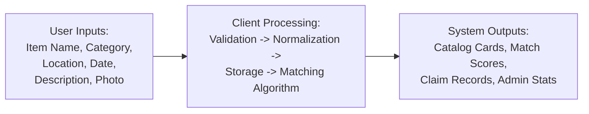

# SOFTWARE REQUIREMENTS SPECIFICATION (SRS)
## Campus Lost-and-Found Matcher

---

## 1. Introduction & User Roles

### 1.1 Purpose
This document provides the definitive specification of functional and non-functional requirements for the **Campus Lost-and-Found Matcher** prototype developed for the Software Prototyping (SP) practical curriculum.

### 1.2 User Roles
1. **Student / Loser (Role: Student-Loser)**:
   - Reports misplaced personal articles.
   - Browses catalog of found items.
   - Receives algorithmic match recommendations.
   - Submits ownership claim requests with non-public proof.
   - Tracks claim and report statuses and marks items recovered.
2. **Student / Finder (Role: Student-Finder)**:
   - Reports discovered articles found on campus.
   - Specifies secure custody or handover location.
   - Maintains privacy without public personal contact disclosure.
3. **Campus Administrator / Security Staff (Role: Admin)**:
   - Reviews all reported items (Lost and Found).
   - Reviews and audits submitted claim requests.
   - Approves legitimate claims or rejects invalid claims.
   - Marks resolved cases and manages demo data resets.

---

## 2. Functional Requirements (FR)

| Req ID | Feature Category | Requirement Description | Priority |
| :--- | :--- | :--- | :--- |
| **FR-01** | Report Lost Item | The system shall provide a dedicated form to log lost articles including: Item Name, Category, Description, Campus Location, Date Lost, Optional Image Upload (preview data URL), and Identifying Characteristics. | High |
| **FR-02** | Report Found Item | The system shall provide a form to log found items including: Item Name, Category, Description, Location Found, Date Found, Optional Image Upload, and Safe Handover Location. | High |
| **FR-03** | Data Validation | All reporting and claim forms shall perform client-side input validation ensuring required fields, valid dates (not future dates), and descriptive minimum lengths before submission. | High |
| **FR-04** | Client Persistence | The system shall store all reports, claims, and state mutations within browser `localStorage` ensuring persistence across page reloads. | High |
| **FR-05** | Catalog Browsing & Search | The system shall provide a search and filter catalog supporting live text search (name and description), Type filter (All/Lost/Found), Category filter, Campus Location filter, and Date filter. | High |
| **FR-06** | Heuristic Matching Engine | The system shall implement a deterministic 100-point matching algorithm evaluating Category match (35 pts), Description keyword overlap (30 pts), Location proximity (20 pts), and Date proximity (15 pts). | High |
| **FR-07** | Match Explanation & Disclaimer | The matching screen shall present a transparent breakdown score for each factor and display a prominent disclaimer that similarity scores do not constitute legal proof of ownership. | High |
| **FR-08** | Ownership Claim Workflow | The system shall allow users to initiate a claim against a found item by providing their identity, justification, and non-public verification details (e.g., hidden marks, serial numbers, wallpapers). | High |
| **FR-09** | Privacy Protection | Non-public verification details shall remain concealed on public cards and catalog listings, accessible only within the claims and admin review modules. | High |
| **FR-10** | User Activity Dashboard | The system shall provide a "My Reports & Claims" view displaying the active demo student's submitted lost/found records, submitted claims, and recovery state toggles. | Medium |
| **FR-11** | Admin Moderation | The system shall provide an administrative portal with global statistics (Total Reports, Open Lost, Open Found, Pending Claims, Resolved) and capabilities to approve/reject claims and mark records as resolved. | High |
| **FR-12** | Demo Seed & Reset | The system shall initialize pre-populated campus test records on first visit and offer a single-click "Reset Demo Data" action to restore baseline test data. | Medium |

---

## 3. Non-Functional Requirements (NFR)

| Req ID | Category | Specification |
| :--- | :--- | :--- |
| **NFR-01** | **Performance** | Page transitions and catalog filtering operations must execute in under 150 ms locally on standard desktop and mobile browsers without network overhead. |
| **NFR-02** | **Zero External Dependencies** | The application must run without requiring server runtimes (Node.js, Python backend), external CSS frameworks (Bootstrap, Tailwind), or database servers. |
| **NFR-03** | **Responsive Layout** | The layout must fluidly adapt across mobile viewports (320px–430px), tablets (768px), and desktop viewports (1024px–1440px+) without horizontal scrollbars. |
| **NFR-04** | **Usability & Aesthetics** | The UI must use a cohesive campus navy/slate palette (`#0f2b48`, `#1d4ed8`, `#f8fafc`), high-contrast typography, intuitive icon indicators, and clear feedback toasts. |
| **NFR-05** | **Accessibility (a11y)** | Form inputs must have explicit semantic labels, clear focus states, legible font sizes (minimum 14px body), and color contrast ratios exceeding WCAG AA standards (4.5:1). |
| **NFR-06** | **Fault Tolerance** | Missing images must gracefully display fallback visual placeholders, and corrupt `localStorage` states must be automatically repaired or reseeded. |

---

## 4. Inputs, Processing, and Outputs

### 4.1 System Inputs
- **Lost Item Form**: Item title, Category (Electronics, ID/Cards, Wallets/Bags, Keys, Stationery, Personal Accessories), Description, Location, Date Lost, Image file (converted to Data URL), Identifying characteristics.
- **Found Item Form**: Item title, Category, Description, Location, Date Found, Image file, Handover/Holding location.
- **Claim Form**: Claimant Name, Roll Number, Claim Justification, Non-public Proof of Ownership.
- **Search & Filter Inputs**: Query keywords, Type selector, Category selector, Campus zone dropdown.

### 4.2 System Processing
- **Sanitization & Normalization**: Text case folding, whitespace trimming, date range checks.
- **Matching Computation**:
  - Category equality: exact match = 35 points, otherwise 0.
  - Keyword extraction: tokenization, removal of English stopwords, Jaccard token overlap scaled to 30 points.
  - Location similarity: exact campus hotspot match = 20 points, related building/zone = 10 points, else 0.
  - Date proximity: difference in days $\Delta d$; $\Delta d \le 1$ = 15 pts, $\le 3$ = 12 pts, $\le 7$ = 8 pts, $\le 14$ = 4 pts, else 0.
- **Storage Lifecycle Management**: LocalStorage serialization, updating record statuses (`Open`, `Claimed`, `Resolved`).

### 4.3 System Outputs
- Filterable item cards with status badges and photo/fallback previews.
- Algorithmic match cards with percentage score and diagnostic reason breakdown.
- Claim submission confirmation receipts.
- Aggregated administrative metrics and status tables.

---

## 5. Assumptions, Constraints, and Feasibility

### 5.1 Assumptions
- All users access the prototype through modern web browsers supporting ES6 JavaScript and HTML5 LocalStorage (Chrome, Firefox, Safari, Edge).
- Users operate in good faith during demo walkthroughs; administrative verification simulates campus security checks.
- Test scenarios reflect typical undergraduate engineering campus layouts.

### 5.2 Constraints
- **Client-Side Only**: No server-side relational database or cloud sync; records reside in the active browser's local sandbox.
- **Framework Ban**: Strictly forbidden from using React, Vue, Angular, TypeScript, Tailwind, or Bootstrap to satisfy the college syllabus requirements.
- **Simulated Auth**: Administrative privileges and student sessions operate via lightweight client role switching for demonstration clarity.

### 5.3 Feasibility Analysis
- **Technical Feasibility**: High. Standards-compliant HTML5/CSS3/JS is supported universally across all desktop and mobile platforms with zero runtime installation overhead.
- **Operational Feasibility**: High. Intuitive self-service interfaces require no user training; workflow mimics familiar student portals.
- **Schedule Feasibility**: Highly achievable within the Software Prototyping project submission timeline.

---

## 6. Acceptance Criteria

1. **AC-01**: A user can submit a valid Lost Item report and immediately locate it in the catalog and "My Reports" view without reloading errors.
2. **AC-02**: A user can submit a valid Found Item report with safe handover information.
3. **AC-03**: The Browse view dynamically filters records across keyword search, category, location, and report type.
4. **AC-04**: The Matches engine accurately scores the seeded Wallet test pair above 85% and displays the exact itemized points breakdown.
5. **AC-05**: Submitting an ownership claim records the claim under "Pending" status and displays it on the Admin Dashboard without revealing private proof publicly.
6. **AC-06**: An Administrator can approve or reject a pending claim, and the change updates the item status accordingly.
7. **AC-07**: The entire prototype maintains complete layout responsiveness from 320px mobile screens to desktop widths without horizontal scroll clipping.
8. **AC-08**: A "Reset Demo Data" action reliably restores all baseline test records.
