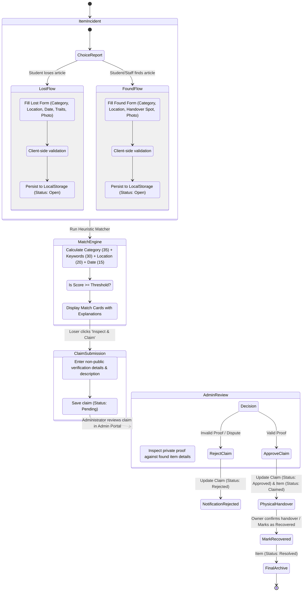
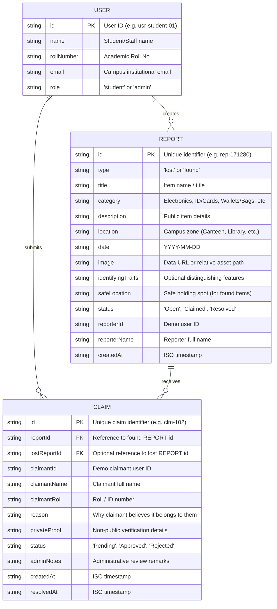

# UML SYSTEM ARCHITECTURE & DIAGRAMS SPECIFICATION
## Campus Lost-and-Found Matcher

This document details the architectural models, system actors, use cases, activity workflows, and sequence of interactions for the **Campus Lost-and-Found Matcher**. The diagrams below use standards-compliant **Mermaid** notation and serve as authoritative reference blueprints for recreating diagrams in modeling tools such as **Lucidchart**.

---

## 1. System Actors & Use Case Specifications

### Primary Actors
1. **Student / Loser**: Campus user reporting misplaced personal items, reviewing automated matches, submitting claims with proof, and marking items recovered.
2. **Student / Finder**: Campus user reporting discovered articles, providing safe custody location details.
3. **Campus Administrator / Security Officer**: Staff reviewing reported items, auditing submitted claims, approving/rejecting ownership claims, and managing database state.

### System Boundary: Campus Lost-and-Found Matcher
The system encapsulates intake forms, local storage persistence, search/filter indices, rule-based matching calculation, claim lifecycle tracking, and administrative moderation.

---

## 2. Use Case Diagram

```mermaid
flowchart TD
    subgraph Campus_Lost_and_Found_System["Campus Lost-and-Found Matcher System Boundary"]
        UC1(["UC-01: Report Lost Item"])
        UC2(["UC-02: Report Found Item"])
        UC3(["UC-03: Browse & Search Catalog"])
        UC4(["UC-04: View Algorithmic Matches"])
        UC5(["UC-05: Submit Ownership Claim"])
        UC6(["UC-06: Track Personal Reports & Claims"])
        UC7(["UC-07: Mark Item as Recovered"])
        UC8(["UC-08: Moderate & Audit Claims"])
        UC9(["UC-09: Resolve / Delete Records"])
        UC10(["UC-10: Reset Demo Dataset"])
    end

    StudentLoser["Student / Loser"]
    StudentFinder["Student / Finder"]
    Admin["Campus Admin / Security"]

    StudentLoser --> UC1
    StudentLoser --> UC3
    StudentLoser --> UC4
    StudentLoser --> UC5
    StudentLoser --> UC6
    StudentLoser --> UC7

    StudentFinder --> UC2
    StudentFinder --> UC3
    StudentFinder --> UC6

    Admin --> UC3
    Admin --> UC8
    Admin --> UC9
    Admin --> UC10
```



---

## 3. Activity Diagram: End-to-End Item Lifecycle

This activity diagram describes the end-to-end flow from when an item is lost or found through algorithmic matching, verification, and final handover.



---

## 4. Sequence Diagram: Match Discovery, Claim Submission, and Admin Approval

This sequence diagram depicts object interactions between the User, Web UI Components, Storage Controller, Matching Engine, and Administrator.

```mermaid
sequenceDiagram
    autonumber
    actor Student as Student (Loser)
    participant UI as Browser UI (pages/matches.html)
    participant Engine as MatchingEngine (js/matching.js)
    participant Store as LocalStorage (js/storage.js)
    actor Admin as Campus Admin (Security)

    Note over Student, UI: Step 1: Discovering Matches
    Student->>UI: Navigate to "Possible Matches"
    UI->>Store: getReports() [Lost & Found]
    Store-->>UI: Return lost and found report records
    UI->>Engine: evaluateMatches(lostReports, foundReports)
    Note over Engine: Calculates Category, Keywords, Location, and Date scores
    Engine-->>UI: Return ranked match pairs with score breakdowns
    UI-->>Student: Render match cards with heuristic breakdown

    Note over Student, UI: Step 2: Submitting Claim Request
    Student->>UI: Click "Inspect & Claim" on high-scoring match
    UI-->>Student: Display Item Details & Claim Form
    Student->>UI: Submit claim (Name, Roll, Reason, Hidden Proof)
    UI->>Store: saveClaim(claimData)
    Note over Store: Validates and saves claim record with status: "Pending"
    Store-->>UI: Claim saved successfully
    UI-->>Student: Show confirmation banner & update "My Reports & Claims"

    Note over Admin, Store: Step 3: Administrative Verification & Resolution
    Admin->>UI: Open Admin Dashboard (pages/admin.html)
    UI->>Store: getClaims() & getReports()
    Store-->>UI: Return all records
    UI-->>Admin: Display pending claims table with non-public proof
    Admin->>UI: Verify details and click "Approve Claim"
    UI->>Store: updateClaimStatus(claimId, 'Approved')
    UI->>Store: updateReportStatus(reportId, 'Claimed')
    Store-->>UI: State updated
    UI-->>Admin: Show success toast; update counter badges
    Student->>UI: Refresh "My Reports & Claims"
    UI->>Store: getMyClaims()
    Store-->>UI: Return updated claim status: "Approved"
    UI-->>Student: Display Approved status & button "Mark as Recovered"
```

---

## 5. Entity-Relationship & Data Model Diagram


